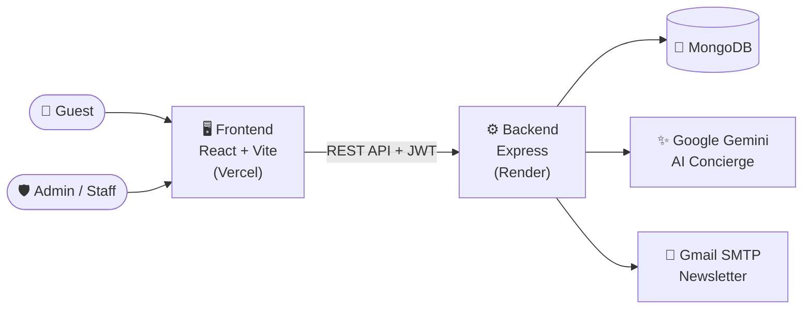
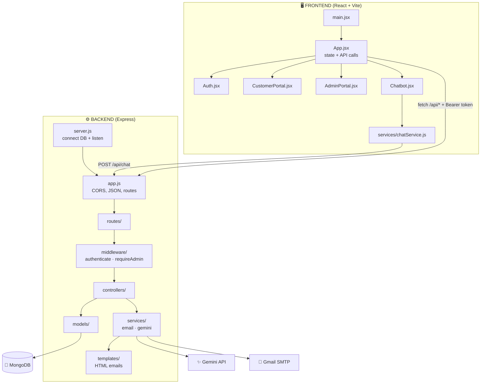
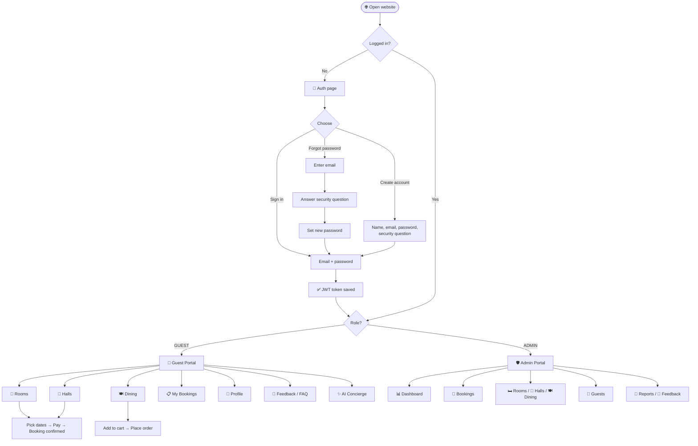
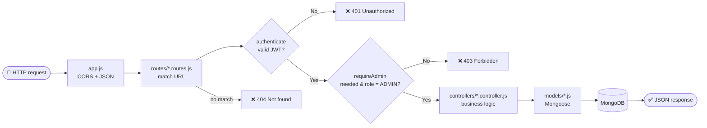
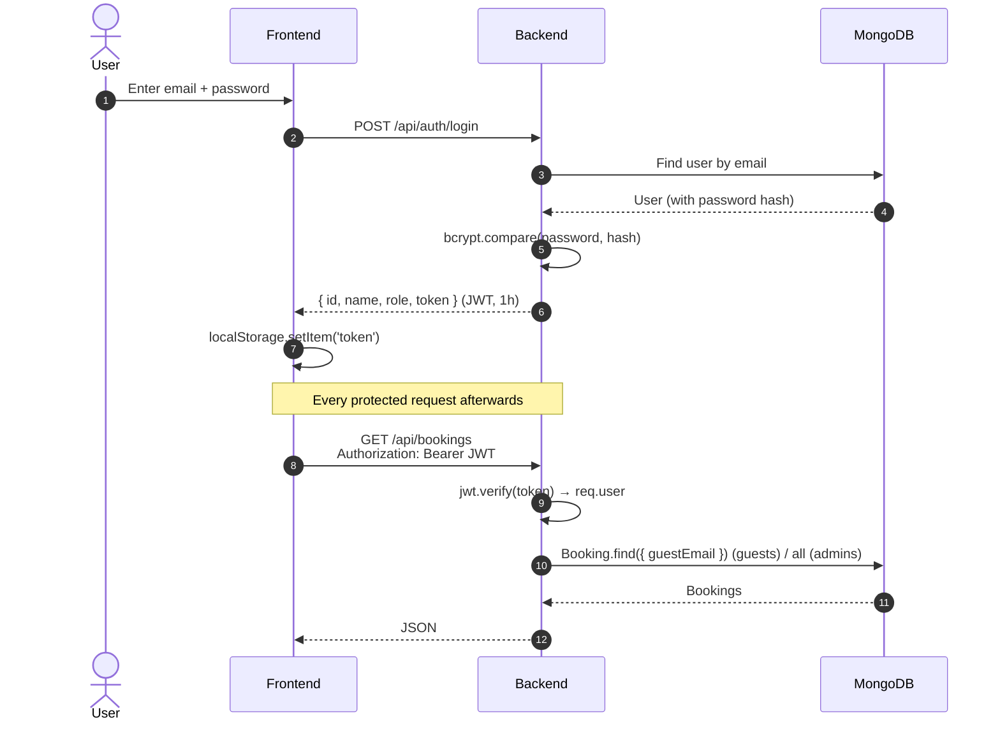
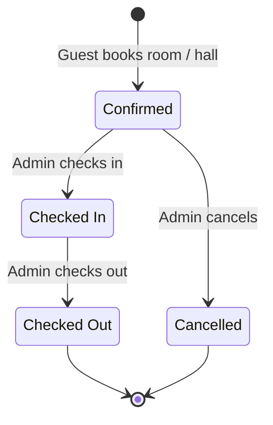
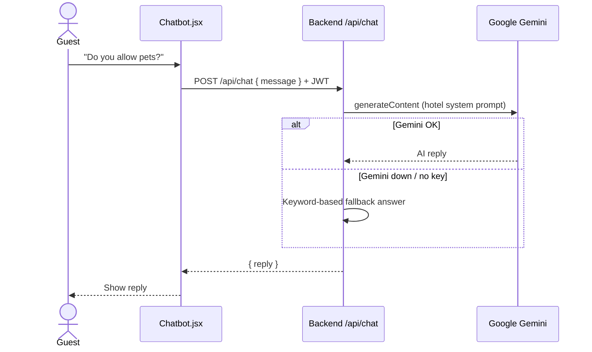
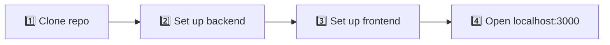
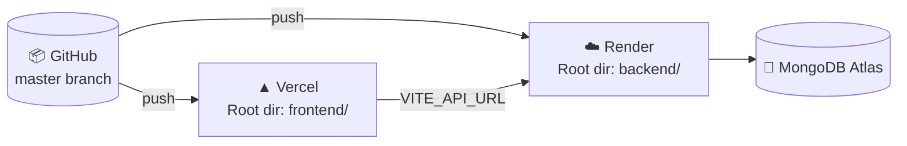

<div align="center">


# ✦ Aetheria Heights ✦
### Luxury Hotel & Event Booking Management System

A full-stack hospitality suite with a **Guest Portal**, an **Admin (Staff) Portal**, and an **AI Concierge** powered by Google Gemini.


</div>

---

## 📑 Table of Contents

- [At a Glance](#-at-a-glance)
- [Features](#-features)
- [System Architecture](#-system-architecture)
- [User Flow](#-user-flow)
- [How a Request Works](#-how-a-request-works)
- [Authentication Flow](#-authentication-flow)
- [Booking Lifecycle](#-booking-lifecycle)
- [AI Concierge Flow](#-ai-concierge-flow)
- [Project Structure](#-project-structure)
- [API Reference](#-api-reference)
- [Permissions](#-permissions)
- [Getting Started](#-getting-started)
- [Environment Variables](#-environment-variables)
- [Deployment](#-deployment)

---

## 🔭 At a Glance



| Layer | Tech | Lives in |
|---|---|---|
| Frontend | React 19, Vite, Tailwind (CDN), Recharts, jsPDF, Lucide icons | [`frontend/`](frontend/) |
| Backend | Node.js, Express 5, Mongoose, JWT, bcrypt, Nodemailer | [`backend/`](backend/) |
| Database | MongoDB | — |
| AI | Google Gemini (`gemini-2.0-flash`), called **server-side only** | [`backend/src/services/gemini.service.js`](backend/src/services/gemini.service.js) |

---

## ✨ Features

<table>
<tr>
<td valign="top" width="50%">

### 👤 Guest Portal
- 🏨 Browse & book **rooms** (Deluxe, Ocean View, Penthouse)
- 🎪 Book **event halls** (weddings, conferences, banquets)
- 🍽️ Order **dining** from the menu (Veg / Non-Veg)
- 📋 **My Bookings** with PDF receipts & QR check-in
- 👤 **Profile**: photo, ID documents, saved cards, preferences
- 💬 **Feedback & complaints**, FAQ
- 📰 **Newsletter** signup (welcome email)
- ✨ **AI Concierge** chatbot

</td>
<td valign="top" width="50%">

### 🛡️ Admin Portal
- 📊 **Dashboard** with revenue & occupancy charts
- 📅 **Bookings**: check-in, check-out, cancel
- 💰 **Financial** overview
- 🛏️ **Rooms** & 🎪 **Halls**: add / edit / delete, housekeeping status
- 🍽️ **Dining**: manage menu & orders
- 👥 **Guests**: notes, loyalty points & tiers, verify documents
- 📄 **Reports** (PDF export)
- 💬 **Feedback** inbox, ⚙️ Settings

</td>
</tr>
</table>

---

## 🏗️ System Architecture



---

## 🧭 User Flow



---

## 🔄 How a Request Works

Every API call travels through the same layers in the backend:



> Public routes (e.g. listing rooms) skip the auth steps. Routes for guests skip `requireAdmin`.

---

## 🔐 Authentication Flow



Passwords and security answers are **never stored in plain text**; both are hashed with bcrypt.

---

## 📅 Booking Lifecycle



**Room status follows the booking automatically:**

| Booking event | Room becomes |
|---|---|
| Booked / Checked In | 🔴 `Occupied` |
| Checked Out | 🟡 `Dirty` (needs housekeeping) |
| Cancelled | 🟢 `Clean` (available again) |

Payment status: `Pending` → `Paid` → (`Refunded`)

---

## ✨ AI Concierge Flow



🔒 The Gemini API key stays **on the server**. It is never sent to the browser.

---

## 📁 Project Structure

```
booking-management/
│
├── 📂 backend/                        ⚙️ Express + MongoDB REST API
│   ├── 📂 src/
│   │   ├── 📂 config/                 env.js · db.js · mailer.js
│   │   ├── 📂 models/                 User · Profile · Room · Hall · MenuItem
│   │   │                              Booking · DiningOrder · Feedback
│   │   ├── 📂 controllers/            Business logic, one file per resource
│   │   ├── 📂 routes/                 URL → controller mapping (mounted at /api)
│   │   ├── 📂 middleware/             auth (JWT, admin) · error handling
│   │   ├── 📂 services/               email.service · gemini.service
│   │   ├── 📂 templates/              HTML email templates
│   │   ├── app.js                     Express app setup
│   │   └── server.js                  🚀 Entry point
│   ├── .env.example
│   └── package.json
│
├── 📂 frontend/                       🖥️ React + Vite client
│   ├── 📂 src/
│   │   ├── 📂 components/             Auth · CustomerPortal · AdminPortal · Chatbot
│   │   ├── 📂 services/               chatService.js (talks to /api/chat)
│   │   ├── App.jsx                    App state + API calls
│   │   ├── main.jsx                   🚀 Entry point
│   │   └── types.js                   JSDoc type definitions
│   ├── index.html
│   ├── vite.config.js
│   ├── .env.example
│   └── package.json
│
├── render.yaml                        ☁️ Render deployment config
├── LICENSE
└── README.md
```

---

## 📡 API Reference

Base URL: `http://localhost:3001/api`  ·  🔓 public  ·  🔑 login required  ·  🛡️ admin only

<details>
<summary><b>🔐 Auth</b></summary>

| Method | Endpoint | Access | Description |
|---|---|---|---|
| POST | `/auth/register` | 🔓 | Create account (+ profile) |
| POST | `/auth/login` | 🔓 | Returns JWT |
| POST | `/auth/forgot-password/question` | 🔓 | Get security question |
| POST | `/auth/forgot-password/verify` | 🔓 | Check security answer |
| POST | `/auth/forgot-password/reset` | 🔓 | Set new password |

</details>

<details>
<summary><b>🏨 Rooms · 🎪 Halls · 🍽️ Menu items</b></summary>

| Method | Endpoint | Access |
|---|---|---|
| GET | `/rooms` · `/halls` · `/menu-items` | 🔓 |
| POST | `/rooms` · `/halls` · `/menu-items` | 🛡️ |
| PUT | `/rooms/:id` · `/halls/:id` · `/menu-items/:id` | 🛡️ |
| DELETE | `/rooms/:id` · `/halls/:id` · `/menu-items/:id` | 🛡️ |

</details>

<details>
<summary><b>📅 Bookings · 🍽️ Dining orders</b></summary>

| Method | Endpoint | Access | Notes |
|---|---|---|---|
| GET | `/bookings` | 🔑 | Guests get their own, admins get all |
| POST | `/bookings` | 🔑 | |
| PUT / DELETE | `/bookings/:id` | 🛡️ | |
| GET | `/dining-orders` | 🔑 | Guests get their own, admins get all |
| POST | `/dining-orders` | 🔑 | |
| PUT | `/dining-orders/:id` | 🛡️ | |

</details>

<details>
<summary><b>👤 Profiles · 💬 Feedback</b></summary>

| Method | Endpoint | Access | Notes |
|---|---|---|---|
| GET | `/profiles?email=` | 🔑 | Guests always get only their own |
| GET | `/profiles/id/:id` | 🔑 | Own profile (admins: any) |
| POST | `/profiles` | 🛡️ | |
| PUT | `/profiles/:email` | 🔑 | Guests: own only, can't change loyalty / notes / role |
| GET | `/feedbacks` | 🔑 | Guests get their own, admins get all |
| POST | `/feedbacks` | 🔓 | |

</details>

<details>
<summary><b>✨ Chat · 📧 Email</b></summary>

| Method | Endpoint | Access | Description |
|---|---|---|---|
| POST | `/chat` | 🔑 | `{ message }` → `{ reply }` from AI concierge |
| POST | `/newsletter/subscribe` | 🔓 | Sends welcome email |
| POST | `/test-email` | 🛡️ | Check email configuration |

</details>

---

## 🛡️ Permissions

| Action | Visitor | Guest | Admin |
|---|:---:|:---:|:---:|
| View rooms, halls, menu | ✅ | ✅ | ✅ |
| Book rooms / halls, order food | ❌ | ✅ | ✅ |
| See bookings & orders | ❌ | Own only | All |
| Edit profile | ❌ | Own only | Any guest |
| Change loyalty points, tier, admin notes | ❌ | ❌ | ✅ |
| Add / edit / delete rooms, halls, menu | ❌ | ❌ | ✅ |
| Check in / out, cancel bookings | ❌ | ❌ | ✅ |
| Read all feedback | ❌ | ❌ | ✅ |
| Use AI concierge | ❌ | ✅ | ✅ |

---

## 🚀 Getting Started

**Prerequisites:** [Node.js](https://nodejs.org/) 18+ and [MongoDB](https://www.mongodb.com/try/download/community) (local or Atlas)



### 1️⃣ Clone

```bash
git clone https://github.com/anshikaraj08/booking-management.git
cd booking-management
```

### 2️⃣ Backend (terminal 1)

```bash
cd backend
npm install
cp .env.example .env     # then fill in the values
npm run dev              # → http://localhost:3001
```

### 3️⃣ Frontend (terminal 2)

```bash
cd frontend
npm install
cp .env.example .env     # set VITE_API_URL
npm run dev              # → http://localhost:3000
```

### 4️⃣ Open the app

Go to **http://localhost:3000**, create an account, and sign in.

---

## 🔑 Environment Variables

### `backend/.env`

| Variable | Example | Purpose |
|---|---|---|
| `PORT` | `3001` | API port |
| `MONGO_URI` | `mongodb://localhost:27017/aetheria_heights` | Database connection |
| `JWT_SECRET` | `a-long-random-string` | Signs login tokens. **Change in production!** |
| `FRONTEND_URL` | `http://localhost:3000` | Allowed CORS origin |
| `EMAIL_USER` | `you@gmail.com` | Gmail sender for newsletters |
| `EMAIL_PASS` | `abcd efgh ijkl mnop` | Gmail **App Password** (not your normal password) |
| `GEMINI_API_KEY` | `AIza...` | Google Gemini key for the AI concierge |

> 📧 **Gmail App Password:** Google Account → Security → 2-Step Verification → App passwords → create one for "Mail".

### `frontend/.env`

| Variable | Example | Purpose |
|---|---|---|
| `VITE_API_URL` | `http://localhost:3001` | Where the backend lives |

---

## ☁️ Deployment



| Service | Host | Settings |
|---|---|---|
| Frontend | **Vercel** | Root Directory: `frontend` · Framework: Vite · Output: `dist` · Env: `VITE_API_URL` |
| Backend | **Render** | Root Directory: `backend` · Start: `npm start` · Env: all `backend/.env` variables |

[`render.yaml`](render.yaml) describes both services for Render Blueprints.

---

<div align="center">

Made with ❤️ for **Aetheria Heights** · Licensed under [MIT](LICENSE)

</div>
